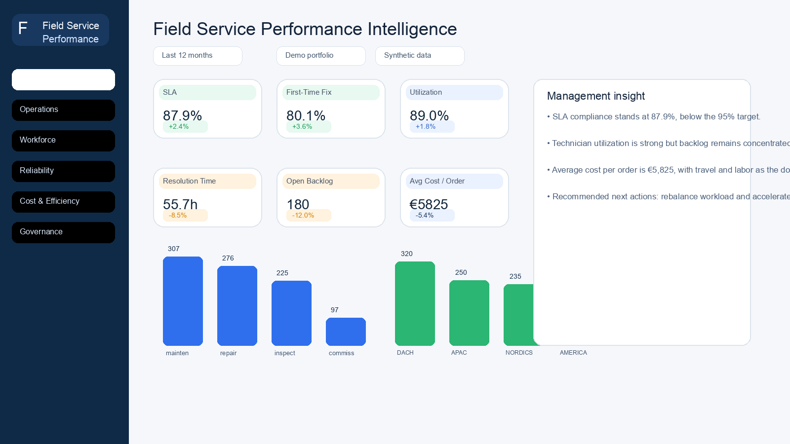
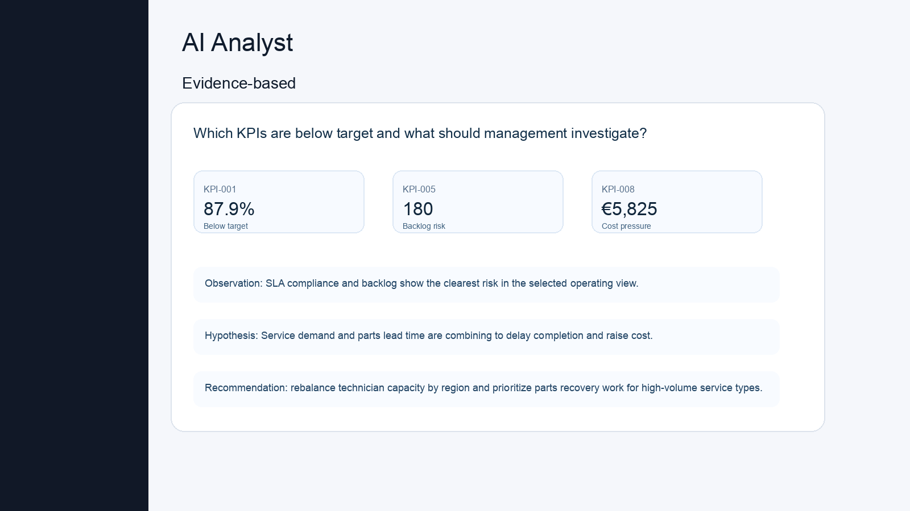
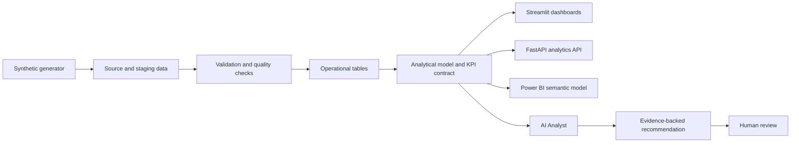
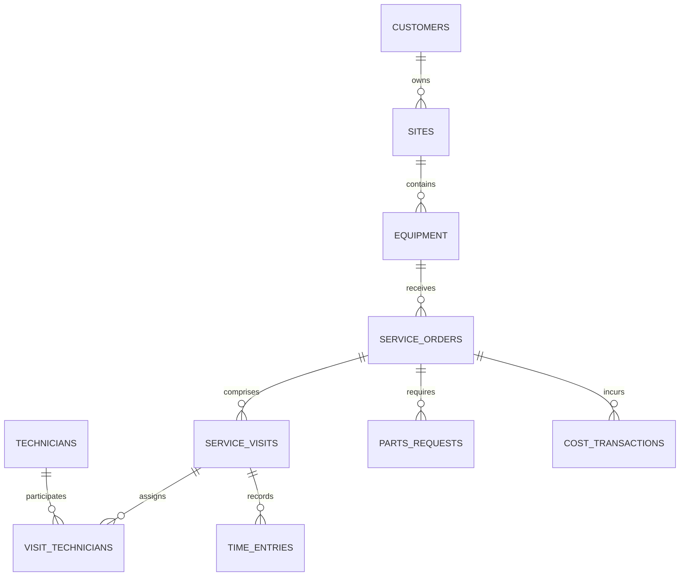
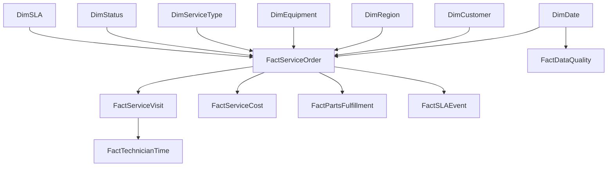
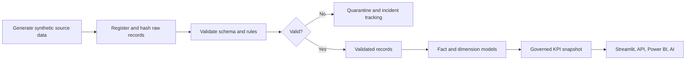
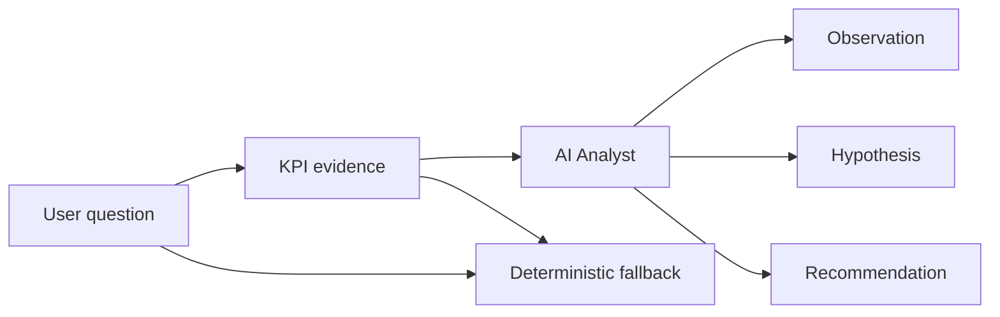

# FieldOps Intelligence

Field Service Analytics and Performance Monitoring

FieldOps Intelligence is a personal project built to explore synthetic field-service data in a realistic, end-to-end way. It combines service orders, technician activity, equipment history, parts demand, and cost data into a single reporting model that can be filtered, analyzed, and explained. The goal is to turn operational information that usually sits across separate systems into a useful dashboard and a small analytics workflow.

The project is intentionally fictional and read-only. It does not use a live operational database or real customer data. Instead, it generates demo data, calculates governed KPIs, validates quality checks, and exposes the results through dashboards, an API, and a Power BI source model.

## Why I built it

I wanted to build something that feels like a real service operations analytics project, but without depending on confidential data. In field-service teams, the hard part is usually not the chart itself — it is bringing together work orders, technician time, parts delays, SLA commitments, and cost information in a way that can be trusted.

This project tries to make that process visible. It pulls the core operational signals into one place, keeps the calculations transparent, and makes it easier to explore what is driving performance. The result is a demo platform for service analysis, KPI review, and operational decision support.

## What it does

The project currently includes the main components that are useful for understanding field-service performance:

- Performance dashboards for service volume, backlog, SLA, utilization, and cost
- Synthetic data generation with controlled defects and reproducible output
- KPI calculation and quality validation on the generated dataset
- FastAPI endpoints for read-only analytics and AI analysis
- A Streamlit app for operational exploration and scenario testing
- A Power BI project source for report modeling and semantic structure
- An AI Analyst that answers questions using only KPI evidence and a safe fallback mode
- Improvement tracking for DMAIC-style cases and actions

Working features are the dashboarding, KPI framework, data generation, API layer, and Power BI source structure. Some items are still incomplete or require external validation, such as final Power BI visual authoring in Windows Desktop and any production-grade authentication or mutation workflow.

## Live demo and screenshots

The public demo is available here:

https://fieldops-intelligence-mirza019.streamlit.app/

The app is read-only and uses the synthetic demo snapshot. The screenshots below come from the project’s current dashboard assets and show the main executive view and the AI Analyst view.



Caption: Executive overview with KPI cards, service demand, and operating context.



Caption: AI Analyst output grounded in the KPI snapshot and evidence-based recommendations.

## How the system works

The application follows a simple pattern: generate data, validate it, calculate governed KPIs, and present them through reporting interfaces.



The synthetic data is produced in a reproducible way and stored in a portable Parquet snapshot. The dashboard and API read from the governed data and KPI contract instead of generating ad hoc UI values. This keeps the reporting layer consistent across dashboards and downstream tools.

## Data model

There are two main model layers in the project.

1. Operational model
2. Reporting model

The operational database is defined in `backend/app/models/database.py` and the Alembic migration under `backend/migrations/versions/0001_enterprise_baseline.py`. The design keeps source-aligned operational tables separate from the analytics layer and uses a six-schema structure: `ops`, `staging`, `mart`, `governance`, `workflow`, and `platform`.



The reporting model is dim-enriched and fact-based. It separates dimensions such as customer, region, equipment, technician, date, status, and service type from fact tables such as service orders, visits, technician time, and service costs.



In plain English, the operational tables store current source-state records, while the analytical tables aggregate them for reporting. That distinction matters because it avoids mixing transaction-level detail with decision-ready KPI results.

## Data pipeline

The project uses a simple pipeline from synthetic generation to validated analytics output. The data generation code lives in `data/generators/generate.py`, and the demo build process is driven by `scripts/build_demo_data.py`.



What already works:

- deterministic synthetic generation with controlled defects
- data validation and rule-based output
- KPI generation and snapshot creation
- read-only dashboard consumption from the snapshot

What is still planned or external:

- broader transactional ingestion orchestration
- live PostgreSQL publish pipeline beyond the portable demo workflow
- full Power BI Desktop visual validation on Windows

## AI Analyst

The AI Analyst is built to answer simple operational questions using only KPI evidence. It does not run arbitrary SQL or inspect the database directly. Instead, it receives a small allowlisted KPI payload, explains the likely issue, and suggests a next step.

The service is implemented in `streamlit_app/services/ai.py` and the fast API uses it in `backend/app/main.py`.



The safe default is a deterministic mock response. If a valid `GEMINI_API_KEY` is present, the app can optionally use Gemini for a live answer path. In both cases, the model is only given KPI values and not unrestricted access to the underlying data.

## Technologies used

| Technology | Purpose |
| --- | --- |
| Python 3.12 | Data generation, analytics, scripts, and API services |
| Pandas / NumPy | Data processing and synthetic generation |
| SQLAlchemy / Alembic | Model definition and migration baseline |
| PostgreSQL | Operational and analytical model structure |
| FastAPI | Read-only analytics API and endpoint protection |
| Streamlit | Dashboard and page-based operational exploration |
| Plotly | Interactive charts in the dashboard |
| React / TypeScript | Frontend command-center style interface |
| Power BI PBIP / TMDL | Reporting source, semantic model, and structural validation |
| Parquet | Portable data snapshot |
| Pytest | Validation and regression coverage |

## Project structure

```text
.
├── analytics/                 # KPI definitions and analytical contracts
├── backend/                  # FastAPI app, models, and migration files
├── data/                     # Synthetic data generation sources
├── docs/                     # Architecture and data-model documentation
├── frontend/                 # React frontend work-in-progress
├── powerbi/                  # Power BI PBIP / report source files
├── scripts/                  # Demo-data build and validation utilities
├── streamlit_app/            # Streamlit dashboard and service layer
├── README.md                 # Project overview and setup notes
├── AGENTS.md                 # Engineering guidance and repo conventions
├── TASKS.md                  # Delivery checklist and implementation status
├── pyproject.toml            # Python package and dependency configuration
├── docker-compose.yml        # Local container setup
├── .env.example              # Sample environment configuration
└── .gitignore
```

## Getting started

This project is intended to run locally on macOS or Linux with Python 3.12.

```bash
python3.12 -m venv .venv
source .venv/bin/activate
pip install -e '.[dev,streamlit]'
python -m scripts.build_demo_data --profile small
streamlit run streamlit_app/app.py
```

Start the backend separately:

```bash
uvicorn backend.app.main:app --reload
```

For the frontend:

```bash
cd frontend
npm install
npm run dev
```

For a local database-backed workflow, use Docker Compose if you want the Postgres-based environment available:

```bash
docker compose up --build
```

Useful validation commands:

```bash
pytest -q
python -m scripts.validate_powerbi
ruff check .
```

## Current status

The project is in a workable demo state. The current implementation includes:

- synthetic data generation
- governed KPI calculation
- Streamlit analytics app
- FastAPI read endpoints
- AI Analyst with deterministic fallback and optional Gemini adapter
- report source metadata and Power BI validation script
- documentation and usage examples

The main external validation items still require Windows Power BI Desktop access and any live Microsoft/Fabric environment.

## What still needs to be done

The most important remaining work is straightforward:

- finish the full reporting authoring work in Power BI Desktop
- validate the analytics layer against a live PostgreSQL environment
- expand the production-grade auth and audit model behind the read-only demo layer
- continue narrowing the gap between the demo model and a fully orchestrated pipeline

## License and data

This project uses fictional synthetic data only. It does not contain real customer records, private operational systems, or proprietary production information.

There is no license file in the repository at the moment, so the repo should be treated as a sample project without an explicit open-source license declaration.

Further references:

- `docs/architecture/system-architecture.md`
- `docs/data-model/physical-model.md`
- `docs/diagrams/workflows.md`
- `docs/architecture/data-model.md`
- `powerbi/FieldOpsIntelligence.pbip`
