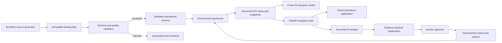

# System architecture

PostgreSQL separates `landing`, `quality`, `core`, `warehouse`, `governance`, and `audit` schemas. Pipeline publishing uses a run-scoped staging area and a single transaction for critical analytical updates. APScheduler persists job state and uses a database advisory lock to prevent overlapping runs.

AI tools expose named analytical operations such as `get_kpi_value`, `compare_periods`, and `pareto_delay_reasons`. They accept validated parameters and return an evidence envelope; they do not accept SQL text.

## Security boundary

FastAPI authenticates users and enforces role permissions on every protected endpoint. The browser never connects directly to PostgreSQL. Power BI receives a read-only database identity. Secrets are environment-only. Audit records capture security-relevant mutations and AI tool use without prompt secrets.

