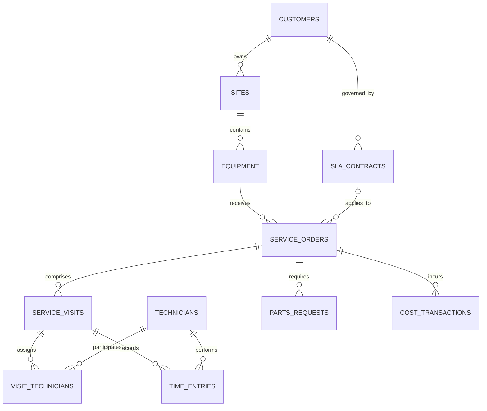

# Enterprise physical data model

Status: implemented in SQLAlchemy metadata and baseline Alembic migration; live PostgreSQL migration execution is pending a running database.

The baseline contains 43 tables: 11 `ops`, 4 `staging`, 15 `mart`, 5 `governance`, 4 `workflow`, and 4 `platform`. The 43rd table, `ops.visit_technicians`, is the normalized junction required by the visit/technician many-to-many relationship.

| Schema | Table | Grain and purpose | Owner | Update / retention |
|---|---|---|---|---|
| ops | customers | One current customer | Master Data | Daily / active + 7y |
| ops | sites | One physical site | Master Data | Daily / active + 7y |
| ops | equipment | One asset | Asset Operations | Daily / asset life + 7y |
| ops | technicians | One technician | Resource Management | Daily / employment + 7y |
| ops | sla_contracts | One effective SLA version | Contract Management | On change / 10y |
| ops | service_orders | One current service order | Field Service | Incremental / 10y |
| ops | service_visits | One visit | Field Service | Incremental / 10y |
| ops | visit_technicians | One technician assignment per visit | Field Service | Incremental / 10y |
| ops | time_entries | One technician activity interval | Field Service | Incremental / 10y |
| ops | parts_requests | One requested part line | Supply Chain | Incremental / 10y |
| ops | cost_transactions | One approved/unapproved cost posting | Finance | Incremental / 10y |
| staging | ingestion_batches | One registered source batch | Data Platform | Per run / 2y |
| staging | raw_records | One immutable source record version | Data Platform | Per run / 2y |
| staging | validated_records | One accepted raw record | Data Platform | Per run / 2y |
| staging | quarantined_records | One rule failure for one raw record | Data Governance | Per run / 7y |
| mart | dim_date | One date | BI | Seeded / permanent |
| mart | dim_customer | One effective customer version | BI | Incremental SCD2 / 10y |
| mart | dim_region | One reporting region | BI | On change / permanent |
| mart | dim_technician | One effective technician version | BI | Incremental SCD2 / 10y |
| mart | dim_equipment | One effective asset version | BI | Incremental SCD2 / 10y |
| mart | dim_service_type | One service type | BI | On change / permanent |
| mart | dim_status | One governed status | BI | On change / permanent |
| mart | dim_sla | One effective SLA version | BI | Incremental SCD2 / 10y |
| mart | fact_service_order | One current analytical order | BI | Per successful run / 10y |
| mart | fact_service_visit | One visit | BI | Per successful run / 10y |
| mart | fact_technician_time | One time entry | BI | Per successful run / 10y |
| mart | fact_service_cost | One approved cost posting in reporting currency | BI | Per successful run / 10y |
| mart | fact_parts_fulfillment | One requested part line | BI | Per successful run / 10y |
| mart | fact_sla_event | One SLA milestone event | BI | Per successful run / 10y |
| mart | fact_data_quality | One rule/dataset/run aggregate | Data Governance | Per successful run / 7y |
| governance | kpi_definitions | One KPI definition version | Performance Governance | On approval / permanent |
| governance | kpi_targets | One effective target and scope | Performance Governance | On approval / permanent |
| governance | quality_rules | One executable rule version | Data Governance | On approval / permanent |
| governance | quality_results | One rule execution | Data Governance | Per run / 7y |
| governance | data_lineage | One lineage edge | Data Governance | On change / permanent |
| workflow | improvement_cases | One DMAIC case | Performance Management | On change / 10y |
| workflow | improvement_actions | One corrective action | Performance Management | On change / 10y |
| workflow | approvals | One human decision | Performance Management | On decision / 10y |
| workflow | alerts | One alert lifecycle | Performance Management | On event / 7y |
| platform | roles | One authorization role | Platform Administration | On change / permanent |
| platform | users | One application identity | Platform Administration | On change / account + 7y |
| platform | pipeline_runs | One orchestration execution | Data Platform | Per run / 2y |
| platform | audit_events | One immutable audited event | Security | On event / 7y |

Column types, nullability, keys, unique constraints, checks, defaults, and indexes are authoritative in `backend/app/models/database.py`. UUIDs identify operational/control entities; integer surrogate keys serve the analytical model. Money is `NUMERIC(18,2)` with a three-character currency. Durations explicitly use hours. All event timestamps are timezone-aware.

