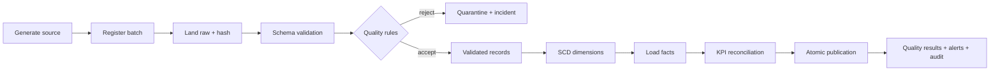
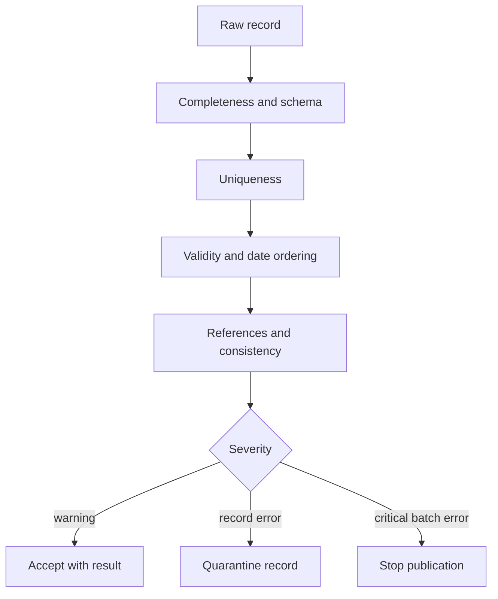
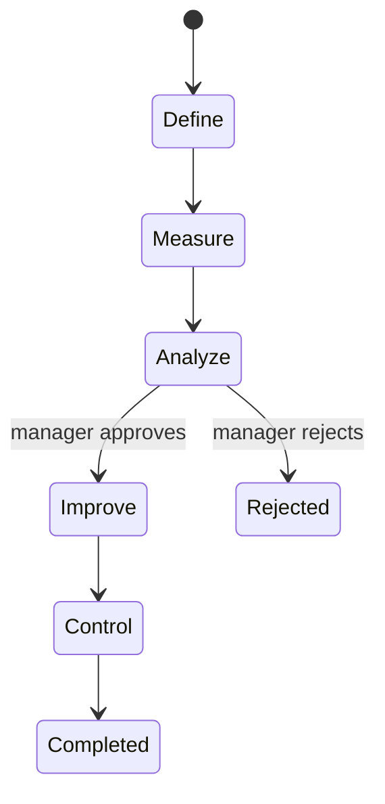
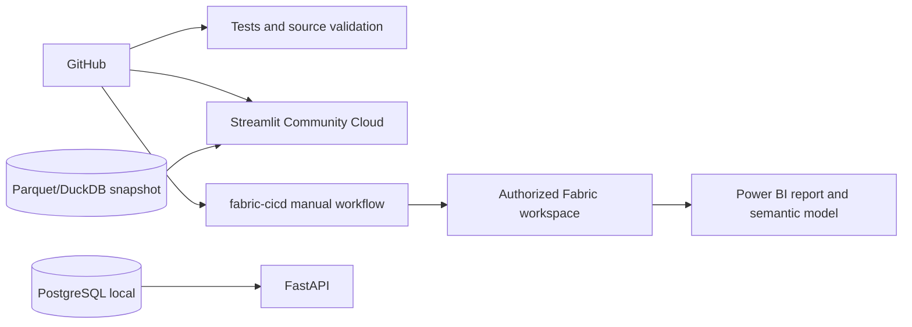

# Architecture workflows

## Incremental pipeline

Unchanged business-key/content-hash pairs are not reinserted. Duplicate events are identified before validation. Late-arriving facts use an inferred/unknown dimension key only where explicitly configured, then are restated after the dimension arrives. Critical failure rolls back the publication transaction while retaining batch diagnostics and a retryable checkpoint.

## Data-quality validation

## AI analytics

## Improvement workflow

## Deployment

